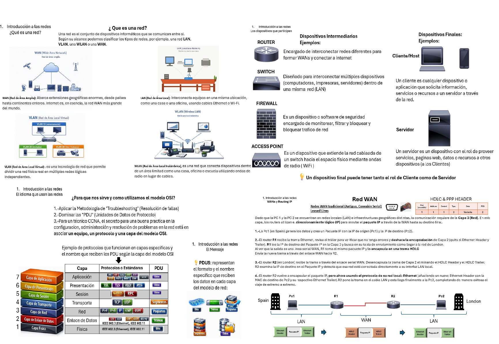

# Ebook-CCNA-Fundamentos-de-redes-by-Win
Me apasionan las redes y con mucho cariño y humildad he realizado una pequeña guia introductoria a las redes para las personas que se quieran preparar para el CCNA. Que la disfruten!.

****Lo tienen disponible en diapositivas:** [Descargar "ccna-guide-win-introduction.pptx"](<ccna-guide-win-introduction.pptx>)**

